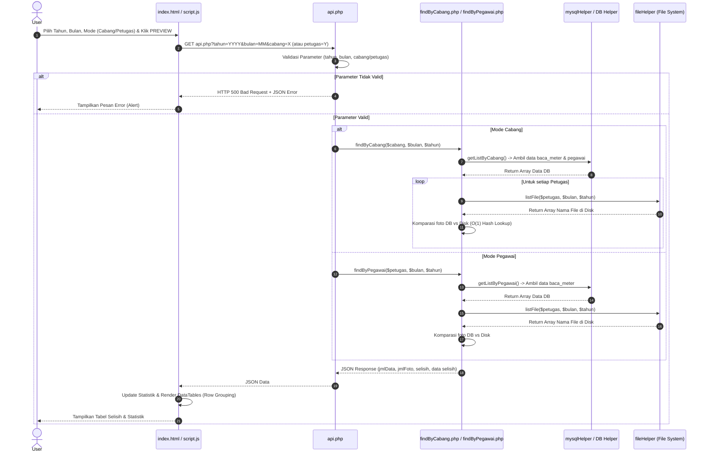

# Dokumentasi Komprehensif: Modul/Repositori `selisih_foto`

Dokumentasi ini menyajikan analisis mendalam terhadap struktur, arsitektur, proses bisnis, alur kerja, fungsi, dependensi, serta algoritma pemrosesan foto dan selisih pada repositori **`selisih_foto`** yang berlokasi di `/mnt/DATA/php/selisih_foto`.

---

## 1. Ikhtisar Proyek & Tujuan (`Overview & Purpose`)

Sistem **`selisih_foto`** adalah utilitas/modul berbasis web mandiri (*standalone PHP web application*) yang dirancang untuk memverifikasi dan menghitung selisih (*discrepancy/gap*) antara **data pencatatan meteran air** yang tersimpan di dalam database MySQL dengan **file foto fisik** yang diunggah dan disimpan di direktori penyimpanan server.

### Fitur Utama:
- **Pencarian Berdasarkan Cabang (`findByCabang`)**: Menganalisis seluruh data pembacaan meter dalam satu wilayah cabang tertentu untuk bulan dan tahun tertentu, mengelompokkannya per petugas, lalu membandingkan keberadaan file foto fisik di disk.
- **Pencarian Berdasarkan Petugas (`findByPegawai`)**: Menganalisis data pembacaan meter untuk petugas pembaca meter (*meter reader*) tertentu.
- **Optimasi Kinerja**: Menggunakan teknik *Connection Pooling*, *Array Lookup Table* (`array_flip` untuk pencarian `O(1)`), dan struktur data terindeks untuk menangani ribuan data pembacaan meter secara efisien.
- **Pelaporan & Ekspor**: Antarmuka interaktif berbasis Bootstrap 5 dan DataTables dengan dukungan ekspor (Excel, PDF, CSV) serta pengelompokan baris (*row grouping*).

---

## 2. Arsitektur & Tech Stack

Sistem ini dibangun menggunakan arsitektur modular sederhana berbasis **Procedural & Object-Oriented PHP** dengan pemisahan tanggung jawab (*separation of concerns*) antara helper database, helper file system, endpoint API, dan antarmuka pengguna frontend.

| Komponen | Teknologi / Pustaka | Keterangan |
|---|---|---|
| **Bahasa Backend** | PHP 8.1+ | Menggunakan fitur modern PHP (strict types, null coalescing, dsb). |
| **Database** | MySQL / MariaDB (`mysqli`) | Manajemen koneksi melalui Singleton `MySQLConnectionPool` dan helper `DB`. |
| **Frontend Framework** | Bootstrap 5.3.2 | Desain antarmuka responsif dan modern. |
| **Tabel & Interaksi** | DataTables (v2 / Plugin) | Tabel data interaktif dengan fitur pencarian, sorting, dan ekspor. |
| **Dropdown UI** | DSelect (v1.0.4) | Peningkatan elemen `<select>` agar dapat dicari (*searchable select*). |
| **Konfigurasi** | Environment (`.env`) | Pengaturan konfigurasi database dan direktori file berbasis file `.env`. |

---

## 3. Struktur Direktori & File Kunci

Berikut adalah struktur pohon direktori dari `/mnt/DATA/php/selisih_foto`:

```text
/mnt/DATA/php/selisih_foto/
├── .env                          # Konfigurasi environment (DB credentials, FILE_BASE_PATH)
├── .gitignore                    # Git ignore rules
├── api.php                       # Endpoint router utama (menangani validasi & routing API)
├── cabang.php                    # API endpoint daftar cabang unik
├── petugas.php                   # API endpoint daftar username petugas
├── findByCabang.php              # Logika pemrosesan selisih foto berdasarkan cabang
├── findByPegawai.php             # Logika pemrosesan selisih foto berdasarkan pegawai
├── index.html                    # Antarmuka pengguna (UI) utama
├── script.js                     # Logika frontend (AJAX fetch, DataTables initialization)
├── core/                         # Direktori modul inti
│   ├── db_helper.php             # Wrapper database & query execution
│   ├── env_loader.php            # Parser file .env sederhana
│   ├── fileHelper.php            # Utilitas pembacaan sistem file direktori foto
│   ├── mysqlHelper.php           # Kumpulan fungsi query SQL (cabang & pegawai)
│   └── mysql_connection_pool.php # Implementasi Singleton Connection Pool MySQL
└── assets/                       # Aset statis (Bootstrap, DataTables, DSelect)
    ├── bootstrap-5.3.2-dist/
    ├── datatable/
    └── dselect-1.0.4/
```

---

## 4. Alur Kerja / Workflow End-to-End

Alur kerja sistem dari sisi pengguna hingga pemrosesan backend dapat direpresentasikan melalui diagram urutan (*sequence diagram*) dan alur proses berikut:



---

## 5. Daftar Modul, Kelas, dan Method Lengkap

### A. Root Script & API
1. **`api.php`**
   - **Tujuan**: Titik masuk utama request HTTP GET dari frontend.
   - **Validasi**:
     - Memastikan parameter `cabang` atau `petugas` terisi.
     - Memastikan `tahun` dan `bulan` tidak kosong.
   - **Routing**: Memanggil `findByCabang()` jika parameter `findByCabang` ada, atau `findByPegawai()` jika sebaliknya.

2. **`cabang.php`**
   - **Tujuan**: Menyediakan data JSON daftar cabang unik dari tabel `pegawai`.
   - **Query**: `SELECT DISTINCT wil AS kd_cabang, cabang FROM pegawai WHERE wil IS NOT NULL AND wil != ''`

3. **`petugas.php`**
   - **Tujuan**: Menyediakan data JSON daftar seluruh petugas dari tabel `users`.
   - **Query**: `SELECT username FROM users ORDER BY username ASC`

---

### B. Modul Logika Komparasi (`findByCabang.php` & `findByPegawai.php`)
1. **`findByCabang($cabang, $bulan, $tahun)`** (`findByCabang.php`)
   - **Parameter**:
     - `$cabang` (`string`): Kode wilayah cabang.
     - `$bulan` (`string`): Bulan (1-12, diformat dengan leading zero jika < 10).
     - `$tahun` (`string`): Tahun (misal: `2026`).
   - **Return**: JSON berformat `{ "jmlData": int, "jmlFoto": int, "selisih": int, "data": array }`.
   - **Cara Kerja**: Mengambil data via `getListByCabang`, mengelompokkan data berdasarkan petugas, membaca file fisik per petugas, membangun lookup table dengan `array_flip`, dan mengumpulkan baris data yang file fotonya tidak ditemukan di disk.

2. **`findByPegawai($pegawai, $bulan, $tahun)`** (`findByPegawai.php`)
   - **Parameter**: Sama seperti di atas, dengan parameter pertama berupa kode/username pegawai.
   - **Cara Kerja**: Mengambil data via `getListByPegawai`, mengambil daftar file di direktori pegawai, melakukan pencarian selisih menggunakan `array_flip` untuk performa `O(1)`, dan menghasilkan rekapitulasi data selisih.

---

### C. Modul Inti (`core/`)
1. **`core/env_loader.php`**
   - Fungsi `env($key, $default = null)`: Membaca file `.env` di root direktori secara *lazy loading* dan menyimpannya ke memori statis.

2. **`core/mysql_connection_pool.php`**
   - Kelas **`MySQLConnectionPool`** (Singleton Pattern):
     - Mengelola kolam koneksi MySQL (`mysqli`) dengan batas maksimal (`DB_MAX_CONNECTIONS`).
     - Method `getConnection()`: Mengambil koneksi siap pakai atau membuat baru jika belum mencapai batas (dengan timeout 5 detik).
     - Method `releaseConnection($connection)`: Mengembalikan koneksi ke pool setelah validasi `ping()`.
     - Method `getPoolStats()`: Mengembalikan statistik penggunaan koneksi.

3. **`core/db_helper.php`**
   - Kelas **`DB`**:
     - `init()`: Inisialisasi pool.
     - `query($sql, $params = [])`: Eksekusi query dengan prepared statements yang otomatis mendeteksi tipe parameter (`i`, `d`, `s`), serta memastikan koneksi selalu dikembalikan ke pool di blok `finally`.
     - `getList($sql, $params = [])`: Menjalankan query dan mengembalikan array asosiatif hasil baris data.

4. **`core/mysqlHelper.php`**
   - `getListByCabang($cabang, $bulan, $tahun)`: Query data `baca_meter` dijoin dengan `pegawai` berdasarkan wilayah cabang dan rentang tanggal awal bulan hingga `LAST_DAY()`.
   - `getUserByCabang($cabang, $bulan, $tahun)`: Mengambil daftar unik petugas pembaca meter dalam suatu cabang.
   - `getListByPegawai($pegawai, $bulan, $tahun)`: Query data `baca_meter` dan `pegawai` berdasarkan username petugas (`b.user = ?`) dan rentang tanggal bulan.

5. **`core/fileHelper.php`**
   - `listFile($petugas, $bulan, $tahun)`:
     - Konstruksi path: `env("FILE_BASE_PATH") . "/$tahun$bulan/$petugas"`.
     - Memeriksa direktori dengan `is_dir()`.
     - Membaca direktori menggunakan `scandir($path, SCANDIR_SORT_NONE)` yang dioptimalkan dengan `array_filter` untuk mengabaikan direktori khusus (`.` dan `..`) serta subdirektori di dalamnya.

---

## 6. Logika & Algoritma Penentuan Selisih Foto

Algoritma pencocokan selisih foto dirancang untuk efisiensi tinggi guna menghindari kompleksitas `O(N * M)`:

1. **Pengambilan Data Database**: Data pembacaan meter untuk periode (bulan & tahun) dan entitas (cabang/petugas) ditarik dari database melalui prepared statement.
2. **Pengambilan File Fisik**: Sistem memetakan direktori penyimpanan foto berdasarkan konfigurasi `.env` (`FILE_BASE_PATH`), struktur folder `YYYYMM/username_petugas/`.
3. **Optimasi Pencarian (`O(1)` Lookup)**:
   - Daftar nama file foto fisik di direktori dibaca menggunakan `scandir`.
   - Array nama file dibalik menggunakan `array_flip($listFile)` sehingga menjadi tabel pencarian (*lookup table*) berbasis kunci (*hash map*).
   - Setiap record dari database yang memiliki atribut nama file foto (`b.file`) dicek keberadaannya menggunakan `isset($fileLookup[$foto])`.
4. **Klasifikasi Selisih**:
   - Jika file ditemukan di lookup table (`isset` bernilai `true`), maka foto dianggap ada (`existingCount++`).
   - Jika file **tidak** ditemukan di lookup table, record data tersebut dimasukkan kedalam array `selisih` (`$result["data"][] = ...`), yang menandakan adanya data pembacaan meter tanpa dokumen foto fisik pendukung.

---

## 7. Integrasi, Dependensi & Konfigurasi Lingkungan

### Konfigurasi `.env` (Contoh)
```env
DB_HOST=localhost
DB_USER=root
DB_PASS=secret
DB_NAME=cater_db
DB_PORT=3306
DB_CHARSET=utf8mb4
DB_MAX_CONNECTIONS=10
DB_TIMEOUT=5
FILE_BASE_PATH=/var/www/html/uploads/foto_meter
```

### Keterangan Integrasi dengan Proyek Utama (`cater_web_ci4`)
Modul `selisih_foto` ini merupakan tool utilitas mandiri berbasis PHP native yang dapat diintegrasikan atau diakses berdampingan dengan sistem utama CodeIgniter 4 (`cater_web_ci4`) melalui konfigurasi basis data yang sama serta sinkronisasi direktori penyimpanan foto (`FILE_BASE_PATH`).

---

## 8. Temuan Riset Tambahan & Rekomendasi

1. **Performansi Sistem File**:
   - Penggunaan `scandir` dengan `SCANDIR_SORT_NONE` dan `array_flip` sangat efisien untuk direktori dengan ribuan file. Namun, jika jumlah file per direktori sangat masif (> 10.000 file), penyimpanan berbasis direktori tunggal dapat mengalami kendala performa sistem file (inode limit / filesystem lookup).
2. **Keamanan & Autentikasi**:
   - Saat ini, endpoint `api.php` dan file-file di root tidak memiliki mekanisme autentikasi/session check bawaan (dapat diakses langsung jika URL diketahui). Disarankan untuk menambahkan middleware session check atau integrasi autentikasi jika diterapkan di lingkungan produksi.
3. **Manajemen Koneksi**:
   - Implementasi `MySQLConnectionPool` dengan Singleton pattern di `core/mysql_connection_pool.php` sudah sangat baik dalam mencegah kebocoran koneksi (*connection leak*) berkat penggunaan blok `try...finally`.

---
*Dokumentasi disusun secara otomatis berdasarkan analisis mendalam repositori `selisih_foto`.*
